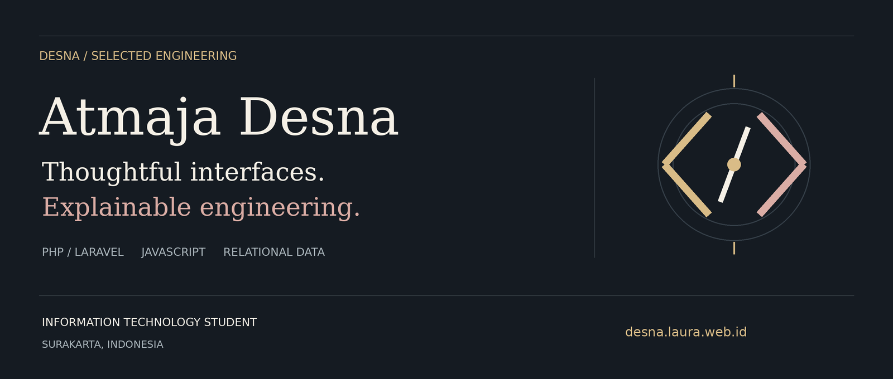
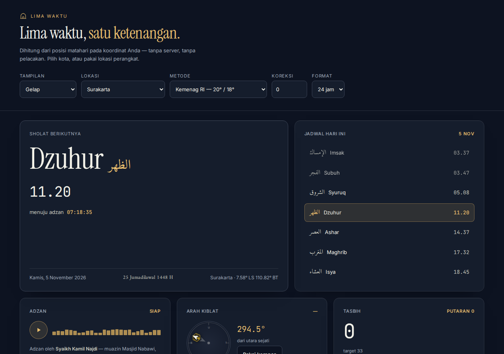
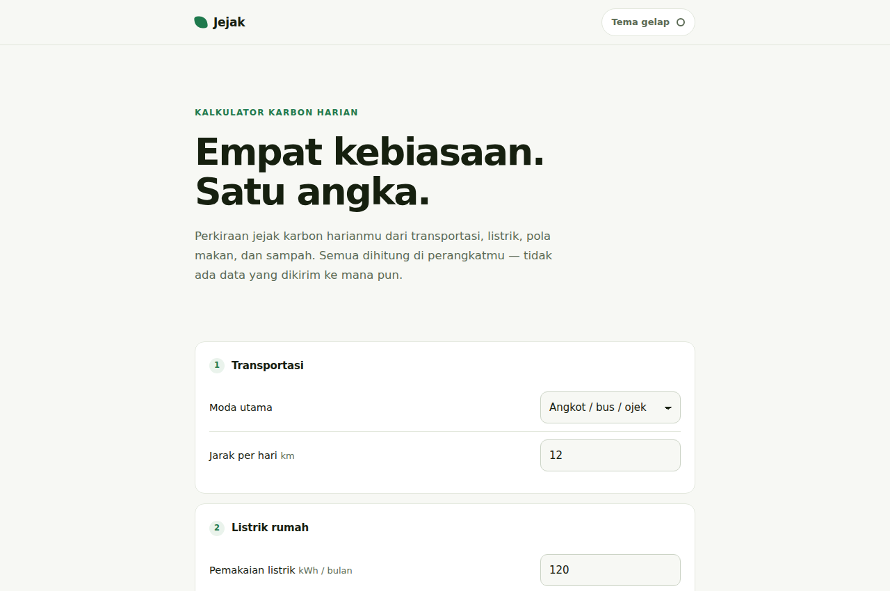

# Atmaja Desna Adinata

**Information Technology student · Web application development · Surakarta, Indonesia**

I build web applications where the interface is clear and the rules behind it can be explained. My work explores **PHP / Laravel, JavaScript, and relational data** through practical problems: inventory costs, fair bill splitting, and location-aware prayer times.

**[Explore my portfolio ↗](https://desna.laura.web.id)** · [Browse source code](https://github.com/atmajadesna?tab=repositories) · [Get in touch](#lets-connect)

---

## Four projects. Four problems worth solving.

**[01 · Lima Waktu](#01--lima-waktu)** · **[02 · Stokara](#02--stokara)** · **[03 · Patungan](#03--patungan)** · **[04 · Jejak](#04--jejak)**

### 01 / Lima Waktu
**Location-aware scheduling · JavaScript · Progressive Web App**

Prayer times calculated on the device, with Qibla direction, configurable adhan reminders, monthly exports, and offline access.

- **The challenge:** a selected city's prayer countdown must not change just because the device uses another timezone.
- **The decision:** derive prayer timestamps from the location's calendar date and UTC offset; persist GPS coordinates and the selected zone across reloads.
- **Verification:** browser regression tests cover GPS persistence, timezone invariance, prayer transitions, and offline reload. Tests are included in the repository.
- **Scope:** calculated estimates, not official schedules. Reminders require an open page; installation does not guarantee background adhan.

**[Try the application ↗](https://atmajadesna.github.io/lima-waktu/)** · [Read the code & tests](https://github.com/atmajadesna/lima-waktu)

### 02 / Stokara
**Inventory & sales · Laravel · SQLite · Local backend prototype**

A small-business inventory ledger connecting batch stock, sales, FIFO cost allocation, and gross profit.

- **The challenge:** a sale needs a traceable cost, not just a stock deduction and an unexplained profit figure.
- **The decision:** connect stock movements to batch-based cost allocation, so the calculation behind a sale can be followed.
- **Scope:** requires local backend setup; it is not presented as a publicly hosted business service.

**[Explore the implementation & setup ↗](https://github.com/atmajadesna/stokara)**

### 03 / Patungan
**Financial calculation · JavaScript · Browser application**

A bill splitter that allocates tax and service charges proportionally.

- **The challenge:** individually rounded shares can fail to add up to the original bill.
- **The decision:** use largest-remainder rounding to distribute the remaining units while preserving the final total.
- **Scope:** a calculation tool, not a payment processor.

**[Try the calculation ↗](https://atmajadesna.github.io/patungan/)** · [Inspect the rounding logic](https://github.com/atmajadesna/patungan)

### 04 / Jejak
**Local calculation · JavaScript · Lightweight interface**

A daily carbon-footprint estimate across transport, electricity, food, and waste.

- **The challenge:** a single total does not show which everyday choice has the largest effect.
- **The decision:** show a category breakdown and tie the suggested next step to the largest estimated source. Calculation stays on the device.
- **Scope:** educational estimates using simplified factors, not a verified carbon audit.

**[Try the calculator ↗](https://atmajadesna.github.io/jejak-karbon/)** · [Read assumptions & source](https://github.com/atmajadesna/jejak-karbon)

---

## Toolkit

- **Backend & data** — PHP, Laravel, MySQL, SQLite
- **Frontend** — JavaScript, HTML, CSS
- **Tools & environment** — Git, Linux, VPS deployment

## What I want a reviewer to find in my code

- **Explainable rules.** Itemized calculations and readable decisions rather than opaque totals.
- **Useful interfaces.** Layouts that work on narrow screens and controls with clear feedback.
- **Checks that can be rerun.** Regression tests where available, plus setup instructions and documented assumptions.
- **Honest boundaries.** A browser demo, a local backend prototype, and a deployed service are different things.

I am continuing to develop these skills through coursework and independent projects—not claiming production-scale experience.

## More experiments

- **[AtmajaCar](https://github.com/atmajadesna/atmajacar)** — date-range availability, itemized pricing, and local bookings. No real reservations or payments.
- **[Absen QR](https://github.com/atmajadesna/absen-qr)** — rotating HMAC attendance codes; a learning prototype with explicit client-side trust limitations.
- **[Jadwal Kuliah](https://github.com/atmajadesna/jadwal-kuliah)** — weekly scheduling with time-and-room conflict detection.
- **[Piksel](https://github.com/atmajadesna/piksel)** — a browser pixel editor with undo history, mirroring, and PNG export.

## Let's connect

For project discussions and professional enquiries:

**[desna.laura.web.id ↗](https://desna.laura.web.id)** · **Email:** atmajadesna [at] gmail [dot] com

Based in Surakarta, Indonesia. Source, setup instructions, and limitations are linked above. No inflated titles, no fictional client work—just projects you can inspect.
