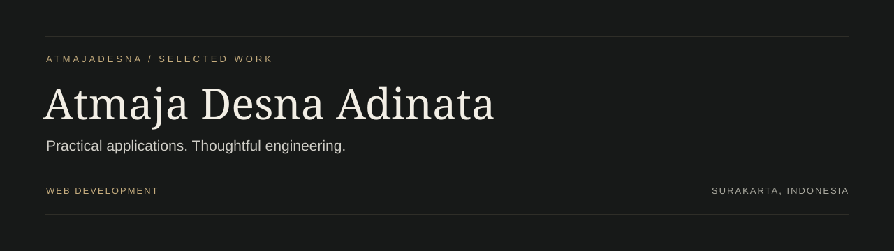
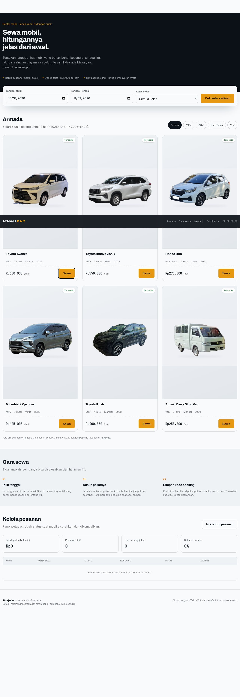

# Web development, grounded in real workflows.

I'm **Atmaja Desna Adinata**, an Informatics student at **STMIK Amikom Surakarta**, Indonesia. I build web applications that turn everyday workflows into clear interfaces and traceable calculations.

My focus is **PHP / Laravel**, **JavaScript**, and **relational data** — from inventory records to booking logic and financial calculations.

**[Explore my portfolio →](https://atmajadesna.github.io)** &nbsp; · &nbsp; [Browse repositories](https://github.com/atmajadesna?tab=repositories)

---

## Selected work

### 01 / Stokara
**Inventory & sales · Laravel · SQLite**

An inventory and sales ledger for small businesses, with batch stock tracking, FIFO cost allocation, and gross-profit calculations.

**Engineering focus:** connecting stock movements to cost allocation, so the calculation behind a sale can be followed rather than hidden behind a total.

[Source & setup →](https://github.com/atmajadesna/stokara)

*Backend prototype; follow the repository setup instructions to run locally.*

### 02 / AtmajaCar
**Booking workflows · JavaScript · HTML / CSS**

A car-rental prototype with date-range availability, optional extras, itemized pricing, and local booking management.

**Engineering focus:** making availability and pricing rules understandable before a booking is confirmed.

[Live demo →](https://atmajadesna.github.io/atmajacar/) &nbsp; · &nbsp; [Source & limitations](https://github.com/atmajadesna/atmajacar)

*Browser prototype. No real reservations or payments.*

### 03 / Patungan
**Calculation logic · JavaScript**

A bill splitter that allocates tax and service charges proportionally, using largest-remainder rounding to keep the final shares consistent with the bill total.

**Engineering focus:** handling the small rounding differences that otherwise make totals disagree.

[Live demo →](https://atmajadesna.github.io/patungan/) &nbsp; · &nbsp; [Source](https://github.com/atmajadesna/patungan)

### 04 / Absen QR
**Attendance workflows · JavaScript · HMAC-SHA256**

A classroom attendance prototype with rotating codes, a QR display, and a local attendance register.

**Engineering focus:** exploring time-limited attendance codes while clearly documenting the trust limits of a client-side implementation.

[Live demo →](https://atmajadesna.github.io/absen-qr/) &nbsp; · &nbsp; [Source & limitations](https://github.com/atmajadesna/absen-qr)

*Learning prototype, not a production anti-cheating system.*

---

## Technical toolkit

- **Backend & data** — PHP, Laravel, MySQL, SQLite
- **Frontend** — JavaScript, HTML, CSS
- **Development tools** — Git, Linux

## How I approach a project

- **Start with the rules.** Understand the workflow, data, and calculations before designing the interface.
- **Make results explainable.** Prefer readable logic and itemized outputs over opaque totals.
- **Check beyond the happy path.** Include edge cases, narrow screens, keyboard navigation, and useful error states in the review.
- **Keep the scope honest.** Distinguish learning prototypes, runnable demos, and applications that need a backend setup.

## More to explore

- [Jadwal Kuliah](https://github.com/atmajadesna/jadwal-kuliah) — weekly scheduling with time-and-room conflict detection.
- [Piksel](https://github.com/atmajadesna/piksel) — browser pixel editor with undo history, mirroring, and PNG export.

---

## Let's connect

For project discussions and professional enquiries:

**[Portfolio →](https://atmajadesna.github.io)** &nbsp; · &nbsp; **Email:** atmajadesna [at] gmail [dot] com

Based in Surakarta, Indonesia. Project scope, setup instructions, and known limitations are documented in each repository.
