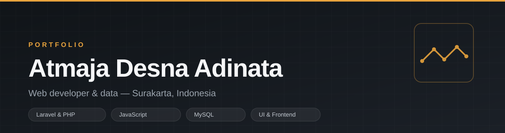
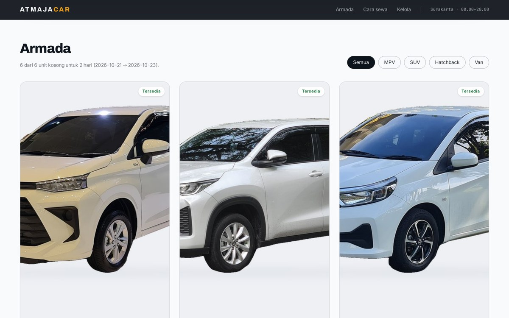
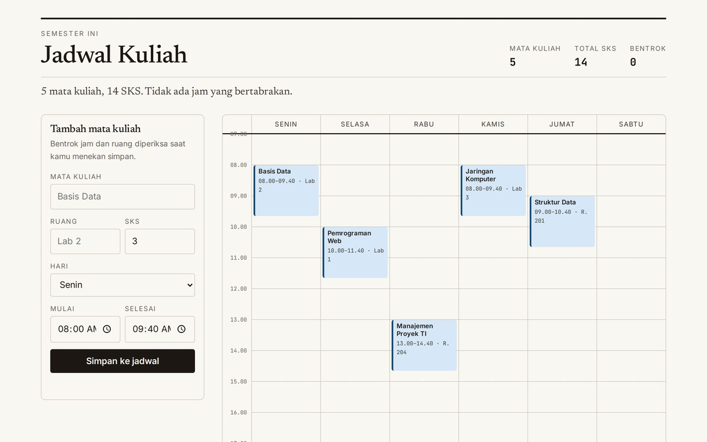

  

 

Mahasiswa Teknik Informatika di **STMIK Amikom Surakarta**. Gw lebih sering bikin aplikasi
yang punya alur, hitungan, dan data — bukan halaman yang cuma bagus di screenshot.

Tiga hal yang gw kejar di tiap project: **hitungannya benar**, **enak dipakai di HP**,
dan **bisa gw jelaskan** — kenapa dibuat begitu, bukan cuma karena bisa.

 

## Project pilihan

<table>
<tr>
<td width="50%" valign="top">
  
  <h3>AtmajaCar — rental mobil</h3>
  
Cek ketersediaan per tanggal: unit yang sudah dipesan di rentang itu otomatis tidak bisa
  dipilih. Rincian biaya terbuka (supir, antar-jemput, asuransi, deposit), panel kelola untuk
  mengubah status pesanan.

  
<code>JavaScript</code> <code>SVG</code> <code>LocalStorage</code>

  
<a href="https://atmajadesna.github.io/atmajacar/"><b>Coba langsung →</b></a> ·
  <a href="https://github.com/atmajadesna/atmajacar">Kode</a>

</td>
<td width="50%" valign="top">
  
  <h3>Absen QR — absensi kelas</h3>
  
Kode 6 karakter yang berputar tiap 30 detik, diturunkan lewat HMAC-SHA256 dari kunci sesi.
  Kode yang difoto lalu dikirim ke teman sudah kedaluwarsa sebelum sempat dipakai.

  
<code>Web Crypto</code> <code>HMAC</code> <code>QR</code>

  
<a href="https://atmajadesna.github.io/absen-qr/"><b>Coba langsung →</b></a> ·
  <a href="https://github.com/atmajadesna/absen-qr">Kode</a>

</td>
</tr>
<tr>
<td width="50%" valign="top">
  
  <h3>Patungan — bagi tagihan</h3>
  
Pajak dan service dibagi proporsional sesuai pesanan, sisa pembulatan dibagi dengan
  <em>largest remainder</em> supaya jumlah semua orang pas sampai rupiah terakhir.

  
<code>JavaScript</code> <code>Algoritma</code> <code>LocalStorage</code>

  
<a href="https://atmajadesna.github.io/patungan/"><b>Coba langsung →</b></a> ·
  <a href="https://github.com/atmajadesna/patungan">Kode</a>

</td>
<td width="50%" valign="top">
  
  <h3>Jadwal Kuliah</h3>
  
Grid mingguan Senin–Sabtu dengan deteksi bentrok jam <em>dan</em> ruang. Blok yang
  bertabrakan langsung ditandai, total SKS dihitung otomatis.

  
<code>CSS Grid</code> <code>Interval</code> <code>LocalStorage</code>

  
<a href="https://atmajadesna.github.io/jadwal-kuliah/"><b>Coba langsung →</b></a> ·
  <a href="https://github.com/atmajadesna/jadwal-kuliah">Kode</a>

</td>
</tr>
</table>

**Juga:** [Pinjam Sehat](https://pinjamsehat.laura.web.id) — sistem pinjaman Laravel dengan
kalkulator angsuran multi-tenor, bunga 0,5–3% per bulan mengikuti aturan OJK, denda harian,
dan bunga efektif tahunan. Login dua peran dengan pembatasan akses berlapis.

 

## Perkakas

 

## Cara gw kerja

- **Baca masalahnya dulu.** Sebelum nulis kode, gw tulis dulu aturannya di kertas: apa yang
  dihitung, dari mana angkanya, kapan dianggap salah.
- **Hitung manual sebelum percaya aplikasi.** Bunga, pembulatan, denda — gw hitung sendiri
  pakai kalkulator, baru hasil aplikasi gw bandingkan.
- **Tes di layar sempit duluan.** Kalau di 320px masih rapi, di laptop hampir pasti aman.

 

## Kontak

- Portofolio: **[atmajadesna.github.io](https://atmajadesna.github.io)**
- Email: **atmajadesna [at] gmail [dot] com**

Semua project di atas bisa dibuka langsung di browser — tidak perlu install apa pun.
