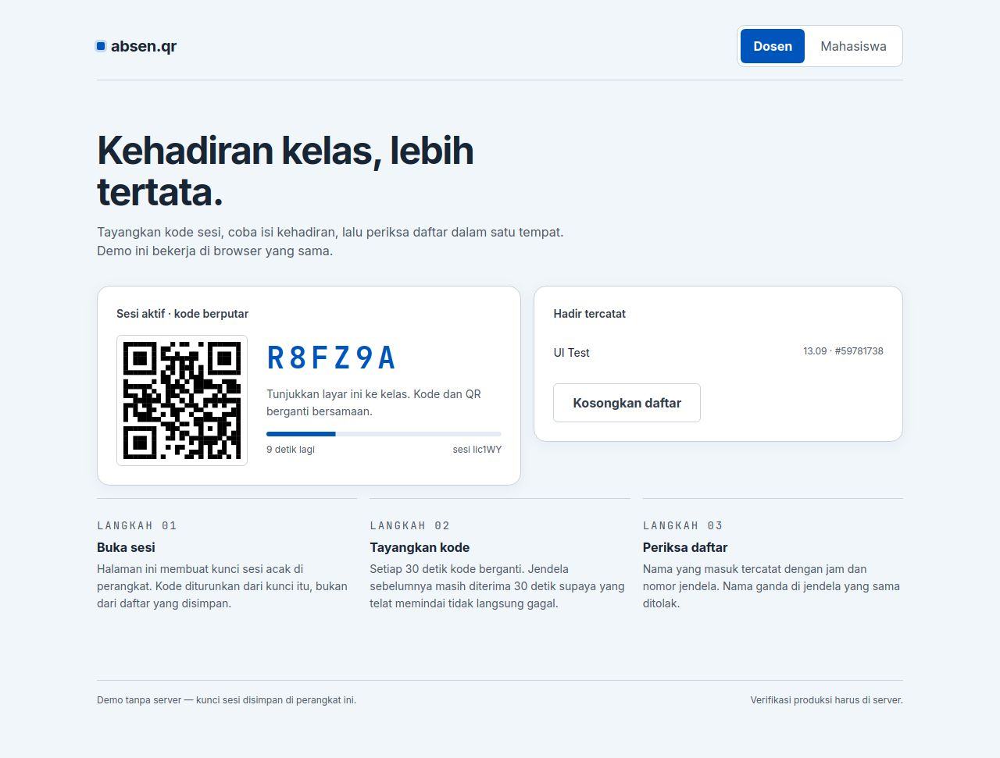

# Atmaja Desna Adinata

Informatics student at **STMIK Amikom Surakarta**, exploring web development, application workflows, and data management.

I build practical prototypes with attention to readable interfaces, clear calculations, and usable mobile layouts.

[Portfolio](https://atmajadesna.github.io) · [Repositories](https://github.com/atmajadesna?tab=repositories)

## Selected projects

### AtmajaCar

Car rental prototype with date-range availability, optional extras, itemized pricing, and local booking management. No real payments or reservations.

[Try demo](https://atmajadesna.github.io/atmajacar/) · [Source and limitations](https://github.com/atmajadesna/atmajacar)

### Absen QR

Classroom attendance prototype with rotating HMAC-SHA256 codes and a local attendance register. A client-side demonstration, not a production anti-cheating system.

[Try demo](https://atmajadesna.github.io/absen-qr/) · [Source and limitations](https://github.com/atmajadesna/absen-qr)

### Patungan

Bill-splitting tool with proportional taxes and service charges, using largest-remainder allocation for rounding.

[Demo](https://atmajadesna.github.io/patungan/) · [Source](https://github.com/atmajadesna/patungan)

### Jadwal Kuliah

Weekly class scheduler with time and room conflict detection and credit totals.

[Demo](https://atmajadesna.github.io/jadwal-kuliah/) · [Source](https://github.com/atmajadesna/jadwal-kuliah)

## More projects

- [Piksel](https://github.com/atmajadesna/piksel): browser pixel editor with history, mirroring, and PNG export.
- [Waktu Sholat](https://github.com/atmajadesna/waktu-sholat): calculated prayer times, Qibla direction, and a digital tasbih. Check local authoritative schedules when using prayer-time estimates.
- [SIMRS Atmaja](https://github.com/atmajadesna/simrs-atmaja): hospital outpatient workflow simulation; not for real patient data.
- [Dheline Caffe](https://github.com/atmajadesna/dheline-caffe): fictional coffee-shop presentation with an interactive photo gallery.
- [Stokara](https://github.com/atmajadesna/stokara): Laravel inventory and sales prototype with FIFO stock flows.
- [Pinjam Sehat](https://github.com/atmajadesna/pinjam-sehat): Laravel loan-management prototype. Not financial advice or a claim of regulatory certification.
- [Sistem Gadai](https://github.com/atmajadesna/sistem-gadai): Laravel pawn-management prototype.
- [Solanapay](https://github.com/atmajadesna/solanapay): digital-wallet simulation; no real funds.

## Tools I work with

PHP · Laravel · JavaScript · HTML · CSS · MySQL · SQLite · Git · Linux

## Working approach

- Understand the workflow and calculation rules before changing the interface.
- Check edge cases and compare results with independent calculations.
- Test narrow screens, keyboard navigation, and meaningful error states.
- Distinguish runnable demos from backend projects requiring local setup.

## Contact

- Portfolio: [atmajadesna.github.io](https://atmajadesna.github.io)
- Email: atmajadesna [at] gmail [dot] com

Project scope, setup instructions, and known limitations are documented in each repository. These are learning projects and prototypes, not production or compliance certifications.
